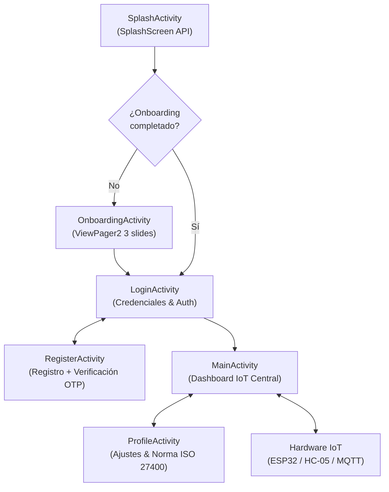

# AeroSmart Home 🍃📱
> **Sistema Inteligente de Climatización, Renovación de Aire y Monitoreo Ambiental IoT**  
> **Asignatura:** Aplicaciones Móviles para IoT (`TI3042`) • **Unidad 2:** Aplicaciones Móviles Android (Evaluación Sumativa 25%)

[](#)
[](#)
[](#)
[](#)
[](#)

---

## 📌 1. Descripción del Proyecto y Problemática

En espacios cerrados de alta concurrencia (como oficinas, salas de servidores y aulas de estudio), el aumento imprevisto de la temperatura y la acumulación de calor metabólico humano deterioran rápidamente el confort térmico, aumentando el riesgo de sofocación y degradando la eficiencia operativa.

**AeroSmart Home** resuelve esta problemática interconectando una estación sensora de bajo consumo y un actuador de ventilación forzada con una aplicación móvil Android nativa, asegurando:
1. **Monitoreo ambiental continuo:** Telemetría en tiempo real de temperatura (°C) y humedad relativa (% HR) mediante sensor **DHT11**.
2. **Detección de presencia humana:** Sensor infrarrojo pasivo (**PIR**) para identificar ocupación física en el recinto.
3. **Climatización y ventilación autónoma:** Actuación de un servomotor **SG90** sobre una compuerta de ventilación (0° a 90°) y turbina extractora auxiliar.
4. **Seguridad y Ciberseguridad OT:** Cumplimiento de la norma internacional **ISO/IEC 27400:2022** para salvaguardar credenciales, telemetría y comandos inalámbricos.
5. **Interoperabilidad multi-dispositivo:** Enlace y sincronización inalámbrica en tiempo real entre múltiples dispositivos Android.

---

## 🎯 2. Mapeo y Cumplimiento de Criterios de Evaluación (Unidad 2)

| Criterio | Requisito de la Guía | Implementación en este Repositorio |
| :--- | :--- | :--- |
| **2.1.1** | **Herramientas de desarrollo móvil y estándar Android** | Desarrollado en Android Studio con Kotlin, arquitectura **MVVM (Model-View-ViewModel)** desacoplada, Jetpack ViewBinding, StateFlow, Coroutines, Material Design 3 y SplashScreen API. |
| **2.1.2** | **Conexiones inalámbricas pertinentes a la problemática** | Soporte de triple canal inalámbrico: **Bluetooth Low Energy (BLE)** en ESP32 para mínimo consumo (&lt;15 mA), **Bluetooth Classic (HC-05)** con perfil SPP serial y **Wi-Fi / Broker MQTT** para telemetría de área amplia. |
| **2.1.3** | **Estándar ISO de seguridad IoT y lineamiento OT** | Conforme a **ISO 27400:2022**: Cifrado en reposo **AES-256** en Jetpack DataStore / EncryptedSharedPreferences, **Hashing Argon2 / SHA-256** con salt para contraseñas, verificación 2FA con **código OTP de 4 dígitos**, canales cifrados TLS 1.3 / BLE Secure Connections y control de acceso por roles (**RBAC**). |
| **2.1.4** | **Interconexión entre al menos dos aplicaciones móviles** | Demostración simultánea de **Dispositivo 1 (Master / Supervisor)** transmitiendo telemetría y órdenes de control al **Dispositivo 2 (Esclavo / Cliente Monitor)** con replicación instantánea y acuse de recibo (**ACK**). |

---

## 🏗️ 3. Arquitectura del Software Android

El proyecto sigue una arquitectura limpia orientada a componentes desacoplados:

```
app/src/main/
├── java/com/example/ventiladorambiental/
│   ├── MainActivity.kt           # Núcleo IoT: Sensores, actuadores, reglas de automatización y BLE
│   ├── MainViewModel.kt          # Gestión de estado reactivo con StateFlow y corrutinas
│   ├── MainUiState.kt            # Modelado de estados de la UI (Loading, Success, Error)
│   ├── LoginActivity.kt          # Autenticación segura con credenciales y recuperación
│   ├── RegisterActivity.kt       # Registro con validación de teléfono de emergencia y OTP de 4 dígitos
│   ├── OnboardingActivity.kt     # Inducción inicial con ViewPager2 e indicadores dinámicos
│   ├── SplashActivity.kt         # Pantalla de carga con verificación de primera sesión en DataStore
│   ├── ProfileActivity.kt        # Gestión de cuenta, alertas y políticas de privacidad ISO 27400
│   └── data/
│       └── UserPreferences.kt    # Persistencia de preferencias mediante Jetpack DataStore
└── res/
    ├── layout/                   # Interfaces XML diseñadas bajo directrices Material 3
    ├── values/colors.xml         # Paleta Slate / Sky Blue / Emerald de alto contraste
    └── drawable/                 # Iconos vectoriales y recursos gráficos optimizados
```

### Flujo de Navegación de la App


---

## ⚙️ 4. Regla de Automatización y Climatización

El núcleo del sistema evalúa continuamente los datos capturados bajo la siguiente lógica industrial:

$$\text{Actuación} = \begin{cases} 
\text{ABRIR ESCOTILLA } (90^\circ) + \text{TURBINA ON } (1850 \text{ RPM}) & \text{si } (T > 26^\circ\text{C}) \land (\text{Presencia} = 1) \\
\text{CERRAR ESCOTILLA } (0^\circ) + \text{TURBINA OFF } (0 \text{ RPM}) & \text{si } (T < 22^\circ\text{C}) \lor (\text{Presencia} = 0) 
\end{cases}$$

> **Nota de Seguridad Operacional (OT):** Si el operador conmuta el interruptor manual de apertura, el sistema desactiva temporalmente el automatismo para respetar de forma inmediata la orden física humana.

---

## 🎨 5. Mockup Interactivo Oficial

Para la evaluación del **Paso 2 y Paso 4**, este repositorio incluye una aplicación de simulación interactiva completa desarrollada en HTML5/CSS3/JavaScript autónomo sin dependencias externas:

* **Ubicación:** [`mockup/index.html`](mockup/index.html)
* **Características del Mockup:**
  * **Chasis de Smartphone Flagship:** Con notch punch-hole, reloj dinámico en la barra de estado y barra de gestos.
  * **Turbina Vectorial Animada:** Aspas SVG con rotación física activa (1850 RPM) y partículas de viento CSS.
  * **Gauges de Sensores:** Zonas de confort térmico dinámicas (Azul frío &lt;22°C, Verde ideal 22-26°C, Rojo alerta &gt;26°C).
  * **Radar PIR Interactivo:** Pulso lumínico ante detección de movimiento de ocupantes.
  * **Panel Lateral de Inyección IoT:** Sliders en vivo de temperatura/humedad, disparo de PIR y consola serial de telemetría a 115200 baudios.
  * **Simulador Multi-Dispositivo (Criterio 2.1.4):** Botón superior para alternar a la vista lado a lado de dos smartphones sincronizados.
  * **Dossier Académico Integrado:** Modal interactivo con las respuestas completas a los pasos 1, 2, 3 y 4 de la guía.

---

## 🔌 6. Esquema de Conexión de Hardware (ESP32)

| Componente | Pin del Componente | Pin ESP32 / Arduino | Función |
| :--- | :--- | :--- | :--- |
| **Sensor DHT11** | VCC | 3.3V / 5V | Alimentación eléctrica |
| **Sensor DHT11** | GND | GND | Referencia común |
| **Sensor DHT11** | DATA (Señal) | GPIO 4 | Telemetría digital OneWire |
| **Sensor PIR HC-SR501** | VCC | 5V | Alimentación del detector |
| **Sensor PIR HC-SR501** | OUT | GPIO 13 | Entrada digital (1: Movimiento, 0: Reposo) |
| **Servomotor SG90** | VCC / GND | 5V / GND | Alimentación del motor |
| **Servomotor SG90** | PWM (Naranja) | GPIO 18 | Control angular PWM (0° a 90°) |

---

## 🚀 7. Instrucciones para Ejecutar el Proyecto en Android Studio

1. Clona este repositorio o abre la carpeta en **Android Studio**:
   ```bash
   git clone https://github.com/BastianTF/AeroSmart-Home.git
   ```
2. Permite que Gradle sincronice las dependencias del proyecto (`build.gradle.kts`).
3. Conecta un dispositivo físico Android (vía USB con Depuración activada) o inicia un Emulador con Android 7.0+ (API 24 o superior).
4. Presiona **Run 'app'** (`Shift + F10`) en Android Studio.
5. Para probar el mockup interactivo de presentación, abre directamente el archivo [`mockup/index.html`](mockup/index.html) en cualquier navegador web moderno (Google Chrome, Edge, Safari, Firefox).

---

## 👥 Equipo y Créditos
* **Estudiante:** Bastián Flores
* **Asignatura:** Aplicaciones Móviles para IoT (`TI3042`)
* **Docente Evaluador:** Carrera de Ingeniería en Informática / Automatización / Redes
